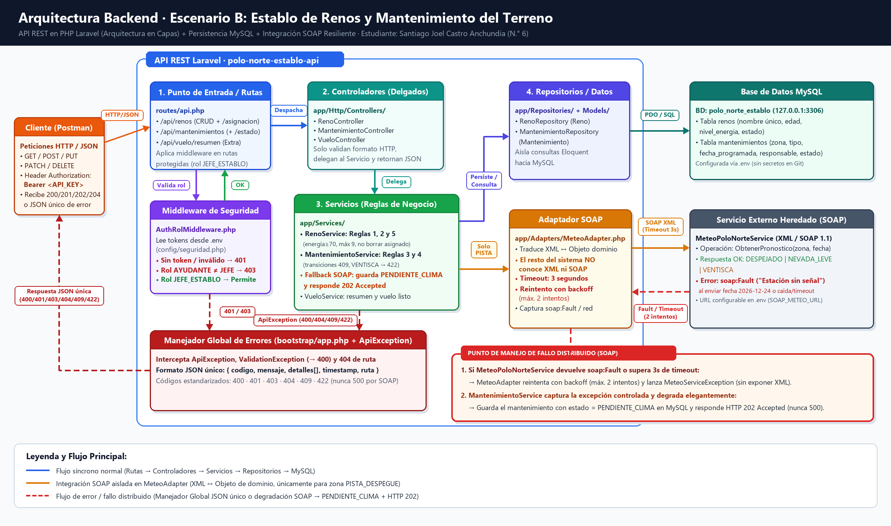

# 🎄 Polo Norte · API del Establo de Renos y Mantenimiento del Terreno (Escenario B)

**Evaluación Parcial 1 · Edición Navideña – Backend y Servicios**  
**Materia:** Desarrollo Basado en Plataformas (UCSG · Grado B-2026)  
**Docente:** Prof. José Miguel Erazo Ayón  
**Estudiante:** Santiago Joel Castro Anchundia (N.º 6 · **Escenario B**)  
**Tecnología:** PHP 8.2 + Laravel 12 + MySQL + Integración SOAP 1.1

---

## 1. Arquitectura del Proyecto

La API implementa una **arquitectura en capas** estricta (`Rutas → Controladores → Servicios → Repositorios/Datos`), con seguridad por roles mediante middleware, manejador global de errores con formato JSON único y aislamiento total del servicio heredado SOAP (`MeteoPoloNorteService`) dentro de `MeteoAdapter`.



### Estructura principal de carpetas

```text
├── app/
│   ├── Adapters/MeteoAdapter.php           # Único punto que conoce XML/SOAP (timeout 3s + 2 intentos con backoff)
│   ├── Exceptions/
│   │   ├── ApiException.php                # Excepción estándar para respuestas JSON de error
│   │   └── MeteoServiceException.php       # Excepción de dominio cuando falla el SOAP
│   ├── Http/
│   │   ├── Controllers/                    # Controladores delgados (sin reglas de negocio)
│   │   │   ├── RenoController.php
│   │   │   ├── MantenimientoController.php
│   │   │   └── VueloController.php
│   │   └── Middleware/AuthRolMiddleware.php # Diferencia 401 (sin token/inválido) y 403 (rol insuficiente)
│   ├── Models/                             # Modelos Eloquent (Reno, Mantenimiento)
│   ├── Repositories/                       # Capa de datos MySQL (RenoRepository, MantenimientoRepository)
│   └── Services/                           # Capa de reglas de negocio (RenoService, MantenimientoService, VueloService)
├── bootstrap/app.php                       # Registro de rutas API, middleware 'rol' y manejador global de errores
├── config/
│   ├── seguridad.php                       # Lee tokens de roles desde .env
│   └── meteo.php                           # Lee URL, timeout y reintentos SOAP desde .env
├── database/migrations/ & seeders/         # Tablas renos y mantenimientos + 10 renos de prueba
├── docs/arquitectura.png                   # Diagrama oficial de arquitectura
├── mock-soap/                              # Mock SOAP local (WSDL + server.php) para pruebas sin dependencia externa
├── postman/                                # Colección Postman exportada (.json)
└── routes/api.php                          # Definición de endpoints REST
```

---

## 2. Cómo levantar el proyecto

### Requisitos previos
- PHP >= 8.2 (con extensiones `pdo_mysql`, `SimpleXML`, `curl`)
- Composer
- MySQL en ejecución (`127.0.0.1:3306`)

### Paso a paso

1. **Instalar dependencias:**
   ```bash
   composer install
   ```

2. **Configurar variables de entorno (sin subir `.env` a Git):**
   ```bash
   copy .env.example .env
   php artisan key:generate
   ```
   Edita `.env` con tus credenciales locales de MySQL y los tokens que desees usar para `API_TOKEN_JEFE_ESTABLO` y `API_TOKEN_AYUDANTE`.

3. **Crear la base de datos en MySQL y ejecutar migraciones + datos de prueba:**
   ```sql
   CREATE DATABASE IF NOT EXISTS polo_norte_establo CHARACTER SET utf8mb4 COLLATE utf8mb4_unicode_ci;
   ```
   ```bash
   php artisan migrate:fresh --seed
   ```
   > El `RenoSeeder` precarga 8 renos clásicos en estado `ASIGNADO_VUELO`, 1 reno con energía baja (`id=9`, `Trueno`, energía 55) y 1 reno en descanso (`id=10`, `Estrella`) para probar las reglas 1, 2 y 5 de inmediato.

4. **Levantar el servidor Mock SOAP local** *(en una terminal aparte; si usas el mock del docente, solo cambia `SOAP_METEO_URL` en `.env`)*:
   ```bash
   php -S 127.0.0.1:4001 mock-soap/server.php
   ```
   - WSDL: `http://127.0.0.1:4001/meteo?wsdl`
   - Endpoint SOAP: `http://127.0.0.1:4001/meteo`

5. **Levantar la API Laravel** *(en otra terminal)*:
   ```bash
   php artisan serve
   ```
   API disponible en: `http://127.0.0.1:8000`

6. **Ejecutar pruebas automatizadas:**
   ```bash
   php artisan test
   ```

---

## 3. Variables de entorno y Tokens de prueba

Consulta `.env.example` para ver todas las variables necesarias:

| Variable | Descripción | Ejemplo (`.env` local) |
|---|---|---|
| `DB_HOST` / `DB_PORT` | Host y puerto de MySQL | `127.0.0.1` / `3306` |
| `DB_DATABASE` | Nombre de la base de datos | `polo_norte_establo` |
| `DB_USERNAME` / `DB_PASSWORD` | Credenciales locales de MySQL | `root` / *(tu clave local)* |
| `API_TOKEN_JEFE_ESTABLO` | Token con rol `JEFE_ESTABLO` (acceso total) | *(definir en tu `.env` local)* |
| `API_TOKEN_AYUDANTE` | Token con rol `AYUDANTE` (provoca `403` en rutas protegidas) | *(definir en tu `.env` local)* |
| `SOAP_METEO_URL` | Endpoint del servicio SOAP `MeteoPoloNorteService` | `http://127.0.0.1:4001/meteo` |
| `SOAP_TIMEOUT_SECONDS` | Tiempo máximo de espera por intento SOAP | `3` |
| `SOAP_MAX_ATTEMPTS` | Máximo de intentos con backoff ante fallo SOAP | `2` |
| `SOAP_BACKOFF_MS` | Espera base entre reintentos (ms) | `300` |

### Uso de tokens en Postman
Envía el header `Authorization: Bearer <TOKEN>`:
- **Sin header o token desconocido:** responde `401 Unauthorized` (`NO_AUTENTICADO` / `TOKEN_INVALIDO`).
- **Con `API_TOKEN_AYUDANTE`:** responde `403 Forbidden` (`ROL_INSUFICIENTE`).
- **Con `API_TOKEN_JEFE_ESTABLO`:** autorizado en `POST/PUT/DELETE /api/renos` y `PATCH /api/renos/{id}/asignacion`.

### Fechas de prueba del Mock SOAP (`PISTA_DESPEGUE`)
- `2026-12-20` → `DESPEJADO` → API responde **`201 Created`** (`PROGRAMADO`).
- `2026-12-21` → `NEVADA_LEVE` → API responde **`201 Created`** (`PROGRAMADO`).
- `2026-12-22` → `VENTISCA` → API responde **`422 Unprocessable Entity`** (Regla 4).
- `2026-12-23` → Retardo de 5s (Timeout > 3s) → 2 intentos con backoff → **`202 Accepted`** (`PENDIENTE_CLIMA`).
- `2026-12-24` → `soap:Fault` (`"Estación sin señal"`) → 2 intentos con backoff → **`202 Accepted`** (`PENDIENTE_CLIMA`).

---

## 4. Endpoints implementados

| Método | Ruta | Descripción | Seguridad |
|---|---|---|---|
| `POST` | `/api/renos` | Registrar reno | `JEFE_ESTABLO` |
| `GET` | `/api/renos` | Listar renos (filtro opcional `?estado=`) | Pública |
| `GET` | `/api/renos/{id}` | Ver detalle de un reno | Pública |
| `PUT` | `/api/renos/{id}` | Actualizar datos de un reno | `JEFE_ESTABLO` |
| `DELETE` | `/api/renos/{id}` | Eliminar reno (Regla 5: no si `ASIGNADO_VUELO`) | `JEFE_ESTABLO` |
| `PATCH` | `/api/renos/{id}/asignacion` | Asignar reno al vuelo (Reglas 1 y 2) | `JEFE_ESTABLO` |
| `POST` | `/api/mantenimientos` | Programar mantenimiento (Regla 4 + fallback SOAP `202`) | Pública |
| `GET` | `/api/mantenimientos` | Listar mantenimientos (filtro opcional `?zona=`) | Pública |
| `GET` | `/api/mantenimientos/{id}` | Ver detalle de un mantenimiento | Pública |
| `PATCH` | `/api/mantenimientos/{id}/estado` | Cambiar estado de mantenimiento (Regla 3) | Pública |
| `GET` | `/api/vuelo/resumen` | **(Extra)** Renos asignados, energía promedio y `vueloListo` | Pública |

---

## 5. Respuesta escrita · Separación en microservicios (máx. 150 palabras)

Dividiría el sistema en dos microservicios independientes, cada uno con su propia base de datos:

1. **Microservicio de Renos (`establo-service`)**: maneja la tabla `renos`, sus validaciones de energía y estado, y la asignación al vuelo (máximo 9 renos).
2. **Microservicio de Mantenimientos (`terreno-service`)**: maneja la tabla `mantenimientos`, sus cambios de estado y la consulta al servicio SOAP del clima con `MeteoAdapter`.

Si el **24 de diciembre a las 23:00** se cae `terreno-service`, el servicio de renos sigue funcionando con normalidad para consultar, editar o asignar renos porque tiene sus propios datos. Solo `GET /api/vuelo/resumen` no podría confirmar en ese instante si la pista está en `COMPLETADO`: usando un timeout corto evitaría quedarse colgado y devolvería `vueloListo: false` (o el último estado guardado) para no autorizar un despegue sin confirmar la pista.

---

## 6. Colección de Postman

Importa el archivo [`postman/escenario-b-establo-renos.postman_collection.json`](postman/escenario-b-establo-renos.postman_collection.json) en Postman y actualiza `token_jefe` y `token_ayudante` con los valores de tu `.env`. Cubre `200`, `201`, `202`, `204`, `400`, `401`, `403`, `404`, `409`, `422` y el caso de SOAP caído.
